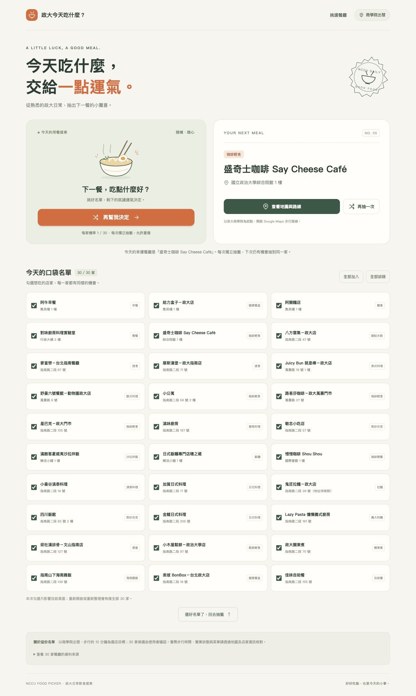

# 政大今天吃什麼？

[直接開啟網站](https://111305066-star.github.io/112305003/) · [完整規格](SPEC.md) · [實際測試紀錄](TESTS.md)

一個從 30 家經使用者確認的政大餐廳候選中，依勾選名單隨機決定下一餐的單頁網頁。使用 HTML、CSS、JavaScript，主程式全部在 `index.html`，無需安裝套件。

## 使用方式
直接以瀏覽器開啟 `index.html`，或透過 GitHub Pages 開啟。

1. 預設選取全部 30 家，可取消不想吃的店。
2. 點擊「幫我決定」抽出一家；每次獨立抽籤，允許重複。
3. 可重新抽籤，或開啟以政大商學院為起點的 Google Maps 步行路線。
4. 重新整理會恢復全部 30 家，頁面中已明確說明。

## GitHub Pages 發布
將 `index.html` 與本說明放在 repository 根目錄，提交至 `main`。在 Settings → Pages 選擇 Deploy from a branch、main、/ (root)，按 Save，等待網站完成部署。

## 規格與資料
完整規格見 `SPEC.md`。餐廳來源可從網頁底部展開，資料整理日期為 2026-10-17。步行約 10 分鐘是以商學院出發的選店目標；實際步行時間及營業現況請查閱地圖與店家資訊。

## 實際設計與修改過程
- 先討論抽餐廳或餐點類型，確認抽出一家實際餐廳。
- 將步行起點從初步假設的正門改為使用者指定的商學院。
- 由使用者選擇簡潔卡片介面及允許重複的獨立抽籤規則。
- AI 搜尋候選店名、地址與來源，依要求由 15 家擴充至 30 家，使用者確認全部採用。
- 依規格製作單一 HTML，加入名單勾選、抽籤動畫、結果卡片、地圖連結與來源清單。
- 操作測試涵蓋空名單、單家、重複抽籤、兩家候選、動畫鎖定、地圖參數與手機排版。
- 手機測試後增加抽籤完成自動捲動到結果卡片，並在名單底部加入回到抽籤連結。

## 修改程式
`index.html` 的 `RESTAURANTS` 為餐廳資料，`:root` 為配色，`WALK_ORIGIN` 為步行起點，`ANIMATION_MS` 為動畫長度。程式內已附註解。

## 介面截圖

[查看手機版畫面](mobile.png)
